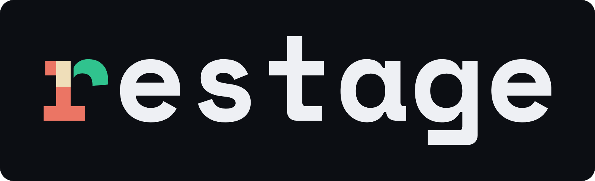

<p align="center">
  <picture>
    <source media="(prefers-color-scheme: dark)" srcset="brand/restage-wordmark-bold-dark.svg">
    <source media="(prefers-color-scheme: light)" srcset="brand/restage-wordmark-bold-light.svg">
    
  </picture>
</p>

<p align="center">
  <a href="https://pub.dev/packages/restage"></a>
  &nbsp;
  <a href="https://github.com/restage-dev/restage/actions/workflows/ci.yml"></a>
  &nbsp;
  <a href="LICENSE"></a>
</p>

<p align="center">
  <a href="https://restage.dev"><b>restage.dev</b></a>
  &nbsp;·&nbsp;
  <a href="https://pub.dev/publishers/restage.dev">Packages on pub.dev</a>
  &nbsp;·&nbsp;
  <a href="QUICKSTART.md">Quickstart</a>
</p>

Restage is server-driven UI for Flutter. Add one annotation to a widget you
already wrote, and it becomes a surface you can publish, measure, and roll back
without a new app build: an onboarding flow, a message, a survey, a paywall, or
any screen. It renders as real Flutter widgets in your app, using your theme.

## Getting started

```dart
import 'package:flutter/material.dart';
import 'package:restage/restage.dart';

part 'restage.generated/welcome.restage.g.dart';

@Screen(id: 'welcome', surface: Surface.message)
final class WelcomeScreen extends StatelessWidget {
  const WelcomeScreen({super.key});
  static const next = SurfaceEvent<void>('next');

  @override
  Widget build(BuildContext context) => Column(
        mainAxisAlignment: MainAxisAlignment.center,
        children: [
          Text('Welcome', style: Theme.of(context).textTheme.headlineMedium),
          FilledButton(onPressed: surfaceEvent(next), child: const Text('Get started')),
        ],
      );
}
```

```sh
dart run build_runner build
```

The build generates `WelcomeScreenSurface`. Mount it in your app and handle its events:

```dart
WelcomeScreenSurface(
  onEvent: (event) => Navigator.of(context).pushNamed('/home'),
)
```

The mount installs the widgets it needs and uses your original widget as a
fallback. For hosted updates, configure Restage at app startup with your public
API key and service URL:

```dart
Restage.configureWithInstalledCatalog(
  apiKey: const String.fromEnvironment('RESTAGE_API_KEY'),
  baseUrl: const String.fromEnvironment('RESTAGE_BASE_URL'),
);
```

Then push the surface and publish it:

```sh
restage surface push welcome
restage surface publish welcome
```

That's it. The [Quickstart](QUICKSTART.md) takes you from install to a
published surface. [`apps/examples`](apps/examples) has starters to copy:
an onboarding flow, a one-screen message, a paywall, a custom widget, and a
screen driven by host data.

## Author, push, and publish

Use the annotation that matches what you build:

- `@Screen(surface: Surface.<category>)` publishes one screen.
- `@Paywall` publishes a paywall. A paywall can also be a step in a flow.
- `@FlowGraph(surface: Surface.<category>)` publishes a typed flow of screens.

`@Screen()` with no category is a screen for use inside a flow. The categories
are `onboarding`, `message`, `survey`, `paywall`, and `general`.

`restage surface push <id>` uploads the artifacts the build generated for that
surface id. `restage surface publish <id>` then makes one pushed revision live.
A push changes nothing that is running. Push ten variants; publish one.

You can also name the file instead of the id:

```sh
restage surface push lib/screens/welcome.dart
```

The CLI resolves the file through the same generated manifest, so it selects
what the build produced. Naming a screen that belongs to a flow pushes that
flow. If a file produced more than one surface, the CLI lists them and asks;
`--all` pushes all of them.

## Why Restage

- **Your widgets, your theme.** You use your own design system. The build
  compiles the code you wrote, and `Theme.of(context)` resolves when the
  surface renders, so a published surface follows your app into dark mode or a
  rebrand.
- **Use it anywhere in the app.** An onboarding flow, a survey, a paywall, a
  whole screen, or one card inside your own `Scaffold`. One runtime renders
  all of them.
- **It has a catalog of 120 widgets** across `restage_core`,
  `restage_material`, and `restage_cupertino`. Add your own widgets with
  `@RestageWidget`.
- **Your app owns the implementation.** What ships is data the app renders.
  Your widgets carry the logic as Dart compiled into your app, and the surface
  composes and configures them. New behavior needs an app release.
- **It measures every version (beta).** Views, taps, and completions are captured
  automatically for each version, with no tracking calls to add. With Restage
  Cloud, A/B tests show which version moves your main metric.
- **It fails safe.** The build stops with an error when it cannot compile
  something. The SDK checks compatibility before rendering an update. If an
  update takes too long, the mount shows a saved version, a bundled copy, or
  your original widget while the fetch continues.
- **Your app controls purchases.** Handle paywall events with your existing
  purchase library, connect RevenueCat with
  [`restage_revenuecat`](packages/restage_revenuecat), or use
  [`restage_store_bridge`](packages/restage_store_bridge) with Flutter’s
  `in_app_purchase` plugin and your own purchase verification.
- **It does not lock you in.** Serve the artifacts from your own server or
  CDN. The SDK works without Restage Cloud.

## Controlled delivery

A surface version never changes after it is pushed. An app that cannot render a
version falls back to a safe one. Restage Cloud adds the controls: roll back, freeze,
or switch off any surface, decide who can publish, and export an audit trail of
what changed, when, and by whom.

Every generated `Surface` mount declares a placement automatically. Use its
ordinary constructor; `.atPlacement('name', ...)` is an optional naming override. The
service can choose compatible content for that placement. See the [SDK placement guide](packages/restage/README.md#placements)
and [delivery commands](packages/restage_cli/README.md#placements-and-delivery-plans).

## Works with

- **A2UI (early):** the same widget constructors emit a genui A2UI catalog, so
  AI-generated UI builds from your real widgets.
- **Widgetbook:** generate stories from the same constructors and browse them
  in a Widgetbook v4 workbench.

## Install

This README describes the current source. Source updates can precede pub.dev
releases; use a release tag’s documentation when working with that release.

```yaml
dependencies:
  restage: ^2.0.0
  restage_material: ^2.0.0

dev_dependencies:
  restage_codegen: ^2.0.0
  build_runner: ">=2.4.0 <3.0.0"
```

Release builds need no special flags. The build step records which widgets
and icons your app uses, and Flutter's icon tree-shaking works as usual.

The `restage` CLI is optional. It is not on pub.dev yet. Clone this repo and
run `melos run cli:install` to compile it onto your PATH.

## Packages

| Package | What it is | License |
|---|---|---|
| [`restage`](packages/restage) | The Flutter SDK that renders surfaces on device | BSD-3 |
| [`restage_core`](packages/restage_core) | Cross-platform widget catalog | BSD-3 |
| [`restage_material`](packages/restage_material) | Material widget catalog | BSD-3 |
| [`restage_cupertino`](packages/restage_cupertino) | Cupertino widget catalog | BSD-3 |
| [`restage_shared`](packages/restage_shared) | Surface format, schemas, and validation shared by the SDK and the toolchain | BSD-3 |
| [`rfw_catalog_schema`](packages/rfw_catalog_schema) | Catalog format and the `@RestageWidget` annotations | BSD-3 |
| [`restage_measurement_schema`](packages/restage_measurement_schema) | Shared data types for measurement and experiments | BSD-3 |
| [`restage_codegen`](packages/restage_codegen) | Build-time toolchain that compiles your Flutter into render artifacts | FSL-1.1-ALv2 |
| [`rfw_catalog_compiler`](packages/rfw_catalog_compiler) | Catalog compiler used by the toolchain | FSL-1.1-ALv2 |
| [`restage_cli`](packages/restage_cli) | The `restage` command-line tool. Not on pub.dev yet | BSD-3 |
| [`restage_mcp`](packages/restage_mcp) | MCP server for agent and tool access. Not on pub.dev yet | BSD-3 |
| [`restage_revenuecat`](packages/restage_revenuecat) | RevenueCat offerings, purchases, restores, and purchase conversion reports. Available from source | BSD-3 |
| [`restage_store_bridge`](packages/restage_store_bridge) | Native store purchases and restores, verified by your app. Available from source | BSD-3 |
| [`restage_a2ui`](packages/restage_a2ui) | App-side capability check for genui A2UI payloads | BSD-3 |
| [`restage_widgetbook_example`](packages/restage_widgetbook_example) | Annotated widget library with generated RFW, A2UI, and Widgetbook output | BSD-3 |
| [`apps/examples`](apps/examples) | Example surfaces to copy | BSD-3 |
| [`apps/widgetbook_example`](apps/widgetbook_example) | Runnable Widgetbook v4 workbench for the generated stories | BSD-3 |

## License

- **BSD-3-Clause** for everything that runs in your app: the SDK, the catalogs,
  the catalog and measurement schemas, the CLI, the MCP server, the A2UI
  check, and the examples. Flutter uses the same license.
- **FSL-1.1-ALv2** for the build-time toolchain (`restage_codegen` and
  `rfw_catalog_compiler`). The source is available. Using it to build your apps
  is free, including use inside your own company; only competing commercial use
  is restricted. Each release converts to Apache-2.0 two years after it ships.

Each package carries its own `LICENSE` file.

## Contributing

See [CONTRIBUTING.md](CONTRIBUTING.md). The widget catalog is the easiest
place to start. To add a widget, you write one curation entry; the registration
is generated.
